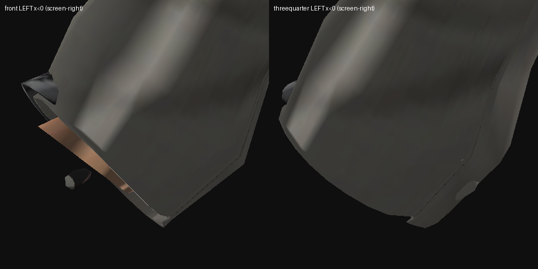
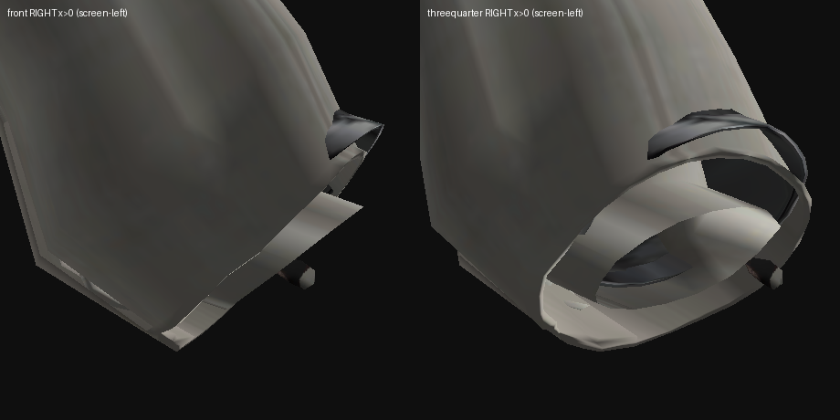
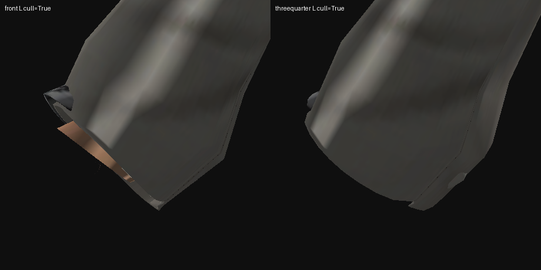
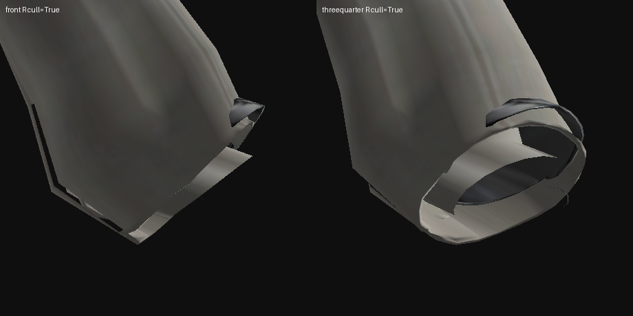

# Arm `mtr_body` Skin Stub + Vanilla `hnd_forearms` Glove Adapter Poke-Through

**Status:** diagnosis complete and measured on the shipped pack; fix plan ready to execute
**Date:** 2026-11-09
**Audience:** a cold-start coding agent with no prior session context
**Primary pack:** `dist/Christie_LAS_Slim.zip` (item `christie_slim`) — the only shipped
pack that takes the `glove_adapter=True` branch
**Control pack:** `dist/Christie_LAS.zip` (item `christie`) — authored hands, no hand cut
**Companion:** `2026-11-09-neck-three-zone-repair-plan.md` (different pass, different file)

Every number in this document was produced by running the code in it against the two
zips in `dist/`. Nothing here is inferred from source reading alone.

---

## 0. TL;DR

The no-hands (glove-adapter) pack ships a **bare-arm skin ring poking out of the left
sleeve** and **no skin at all inside the right sleeve**. Both are visible in the shipped
zip:

| | LEFT arm (`x < 0`) | RIGHT arm (`x > 0`) |
|---|---|---|
| skin (`mtr_body`) arm faces | **160** | **0** |
| skin arm boundary loops | **1** (open mouth) | **0** |
| blazer (`mtr_c02_01`) arm faces | 591 | 745 |
| shirt (`mtr_c02_02`) arm faces | 337 | 342 |



Left cuff: an **open skin cone with a torn mouth protruding from the sleeve**. The right
cuff is worse — no skin at all, you look straight up the sleeve:



Both survive **backface culling** (`preview_textured.render(..., cull=True)`), so this is
real front-facing geometry, not a two-sided-render artefact:




**Root cause, measured:** the mesh is mirror-symmetric (**0.022 cm** median mismatch), so
the geometry was *not* authored asymmetrically. The defect is **one-sided material
assignment**: the bare-arm ring is tagged `mtr_body` on the left and blazer/shirt on the
right (§3.1, §3.4). `cut_hands` then leaves an open boundary at the wrist, and
`extend_sleeves_to_wrist` cannot reach it because it gates on a hardcoded joint table
that is **14 cm off** in the frame it runs in (§3.6).

**Why no existing guard caught it:** every hand-route guard counts **hand** bones. The
stub is weighted to **`LeftForeArm`** — zero hand weight on all 102 verts (§3.2, §7.1 A1).
It is structurally invisible to `count_hand_verts` and `cut_hands`.

---

## 1. Scope

| | |
|---|---|
| Pack | `dist/Christie_LAS_Slim.zip` (item `christie_slim`, `glove_adapter=True`) |
| Builder | `tools/pd2-las/build_christie_las.py` — `IDENTITIES` (`:116`; slim `glove_adapter=True` at `:135`, base `False` at `:125`), `cut_hands` (`:510`), adapter branch (`:3276-3294`) |
| Shared pass | `tools/pd2-las/build_models.py` — `ARM_JOINTS` (`:1847`), `extend_sleeves_to_wrist` (`:1853`), `count_hand_verts` (`:1482`) |
| Hook (read-only here) | `tools/pd2-las/las_outfit_pack.py` — `render_glove_adapter_lua` (`las_outfit_pack.py:80`) |
| Tests | `tests/test_christie_las.py`, `tests/test_glove_adapter.py`, `tests/test_glove_behavior_lua.py` |
| Artefacts | rebuilt `dist/Christie_LAS_Slim.zip` + `dist/Christie_LAS_Slim.zip.sha256` |

**Not in scope:** the neck pass, the sleeve gloss / UV mask, the normal maps, the forearm
normals. Those are separate documents; do not re-litigate them here.

> All `file:line` citations are `HEAD` line numbers. They will drift once you patch —
> **grep for the symbol name**, never trust the number.

---

## 2. Reproduce in one command

Nothing below needs the Skyrim sources, and nothing needs a rebuild.

```bash
cd /tmp && rm -rf chr chr_base && mkdir -p chr chr_base
unzip -o -q /home/user/universal-modder/dist/Christie_LAS_Slim.zip \
    "Christie_LAS_Slim/assets/units/christie_slim/skins/christie_slim/*" -d chr
unzip -o -q /home/user/universal-modder/dist/Christie_LAS.zip \
    "Christie_LAS/assets/units/christie/skins/christie/*" -d chr_base
```

```python
import sys, numpy as np
from pathlib import Path
sys.path.insert(0, "tools/pd2-las")

import preview_textured as pt

SLIM = Path("/tmp/chr/Christie_LAS_Slim/assets/units/christie_slim/skins/christie_slim/christie_slim.model")
BASE = Path("/tmp/chr_base/Christie_LAS/assets/units/christie/skins/christie/christie.model")

for tag, p in (("SLIM", SLIM), ("BASE", BASE)):
    print(f"--- {tag} ---")
    for m in pt.material_meshes(p):
        V, F = m["vertices"], m["triangles"]
        cen = V[F].mean(axis=1)
        L, R = int((cen[:, 0] < -33).sum()), int((cen[:, 0] > 33).sum())
        if L or R:
            print(f"  {m['material']:12s} L={L:5d} R={R:5d}")
# SLIM: mtr_body L= 160 R=   0     <-- the defect
#       mtr_c02_01 L=591 R=745 ; mtr_c02_02 L=337 R=342
# BASE: mtr_body L=1474 R=1224 ; mtr_c02_01 L=584 R=778 ; mtr_c02_02 L=2129 R=342
```

---

## 3. Measurements

### 3.1 The mesh is symmetric; the materials are not

Mirror-test the whole slim body (`x -> -x`, nearest-vertex distance over 800 sampled
verts):

```
median mismatch 0.022 cm, 90th percentile 0.363 cm  => SYMMETRIC
```

Whatever produced the asymmetry did not move geometry. It changed which **material
slice** a symmetric piece of geometry belongs to.

### 3.2 The skin stub, exactly

The 160 `mtr_body` arm faces form one connected open cone:

```
faces       160          verts  102
bbox        x[-49.4, -36.3]   y[-4.2, 3.7]   z[104.4, 119.6]
boundary    1 loop, n=43, centre (-42.6, 0.0, 110.9)
            radius mean 7.06 cm, max 8.82 cm
dominant bone on all 102 verts: LeftForeArm   (hand weight 0 on every vert)
```

One boundary loop, no cap: an **open-ended tube**. Its mouth (`z = 110.9`) sits **1.5 cm
above** the blazer cuff mouth (`z_min = 102.8`), so the blazer opening is *below* the
skin opening — the skin is visible through it and hangs out as the tan flap.

### 3.3 The right side has no skin arm at all

`mtr_body` right arm faces: **0**. No left/right partner for the stub exists, so the
right cuff is an empty blazer ring (`wrist_right_*.png`).

### 3.4 The mirror of the stub is blazer/shirt

Mirroring the 160 stub faces to `x > 0` and asking which material owns the nearest vertex:

```
mtr_body LEFT: 160 arm faces | mirror lands on {'mtr_c02_01': 20, 'mtr_c02_02': 20}
```

The right-hand counterpart of the tan skin stub is **garment** geometry. That is the
whole defect in one line.

### 3.5 Sleeve-mouth radii

| | centre | radius mean | radius max |
|---|---|---|---|
| LEFT cuff ring | (−40.5, 0.6, 109.0) | 2.21 cm | 3.55 cm |
| RIGHT cuff ring | (42.8, 0.0, 110.5) | 4.36 cm | 6.81 cm |

The right mouth is **~2.0× wider** than the left — the same asymmetry seen from the
sleeve side.

### 3.6 `extend_sleeves_to_wrist` cannot see the arm it exists to stretch

The pass (`build_models.py:1853`) gates on the hardcoded `ARM_JOINTS` table (`:1847`):

```python
ARM_JOINTS = {
    -1: ((-45.99, 18.70, 124.47), (-39.50, -0.99, 133.29)),   # wrist, elbow
     1: (( 45.99, 18.70, 124.47), ( 39.50, -0.99, 133.29)),
}
```

keeping a vertex iff `-8 <= t <= 13` **and** `perp <= 7.5`. Re-running those exact gates
on the *shipped* mesh:

```
material     side  t in [-8,13]   +perp<=7.5
mtr_body     R              37             0
mtr_body     L              98             0
mtr_c02_01   R             866             0
mtr_c02_01   L             739             0
mtr_c02_02   R             184             0
mtr_c02_02   L             187             0
```

**Zero vertices pass `perp <= 7.5`.** Christie's skin-arm centroid in the shipped mesh is
`(−43.2, 0.1, 110.7)`; the hardcoded wrist is `(±45.99, 18.70, 124.47)` — **14 cm away in
z alone**. The pass runs *before* `rebind_arms_at_idle` (`build_christie_las.py:3305`)
re-authors the rest pose, so the gate constants are correct at build time and meaningless
in the shipped frame.

> **Do not fix this by re-tuning `perp_max` / `target` against the shipped pose.** That
> fits a constant to a frame the pass never runs in (§8.1).

---

## 4. Root cause

Build order in `build_christie_las.py`:

```
:3276  if identity.glove_adapter:                   # only slim sets this
:3281      groups[gname] = cut_hands(...)          # drop hand/finger-dominant faces
:3282      bm.extend_sleeves_to_wrist(...)         # stretch skin/jacket/shirt over the gap
:3305  idle_rest[gname] = rebind_arms_at_idle(...)  # re-author rest pose, AFTER both
```

**(a) `cut_hands` deletes faces, not materials.** It keeps a triangle iff all three verts
are under the hand-weight threshold (`:510-527`). The DOA5 forearm continues under the
glove, so after the cut the surviving skin is a *ring* around the wrist, still tagged
`mtr_body`, now with an open boundary where the hand was. If
`extend_sleeves_to_wrist` misses it (§3.6), that ring survives as the stub in §3.2.

**(b) The material assignment is one-sided.** §3.4 shows the mirror of the stub is
garment geometry. `slim_group` routes weights per segment (`SEGMENT_SPECS`, `:709`), and
`_classify_palette` (`:933`) puts anything not in
`SEGMENT_SPECS`/`TORSO_BONES`/`SHOULDER_BONES` into `protected`, keeping identity. A
one-sided routing difference is enough to leave one arm's bare ring in `mtr_body`'s slice
and the other's in the garment slices. Because the *geometry* is symmetric (§3.1) the
result is a **left/right material split of the same shape** — which no existing test
asserts.

**(c) It is inherited from the source rig.** The DOA5 source names its bones inverted
relative to `x` sign (`MOT05_LeftHand` dominates `x > 0`) and its
`cri_02_02_base` hand geometry is 100 % one-sided. The builder inherits that sidedness.
**This is not a builder bug to "correct" back to the source** — the source is the wrong
model; the fix is on the *shipped* side (§5).

**Why the existing guards are blind.** `count_hand_verts` (`:1482`) and `cut_hands` both
key on bones named `LeftHand*` / `RightHand*`. The stub's dominant bone is `LeftForeArm`.
So `count_hand_verts` returns 0 and the adapter build passes its own hand guard, correctly,
for what it claims. The defect is one level up: **a visible bare-arm ring in a pack whose
premise is "no arm skin shows; the adapter covers the wrist."**

---

## 5. Implementation options

### 5.1 R1 — make the pass frame-independent (structural, larger blast radius)

Get the axis from the group's own palette, exactly as `rebind_arms_at_idle:1950` does:

```python
A, E, H = [np.asarray(g.rest_worlds[name], float).reshape(4, 4)[3, :3]
           for name in (f"{side}Arm", f"{side}ForeArm", f"{side}Hand")]
wrist, elbow = H, E
```

Pros: correct in any frame, reuses an accessor the neighbouring pass already trusts.
Cons: `extend_sleeves_to_wrist` is shared with `tools/pd2-las/build_skyrim_outfit.py:371`,
whose groups may lack `rest_worlds` — needs a fallback to `ARM_JOINTS`. It also moves the
cuffs on **both** packs, so §7.2 must be re-run on `base` too.

### 5.2 R2 — delete the bare-arm ring from the adapter pack (recommended)

The adapter pack's contract is *no arm skin visible*; the vanilla `hnd_forearms` adapter
supplies the forearm. So for `glove_adapter=True`, delete the skin ring `cut_hands` leaves
instead of stretching it:

```python
def drop_bare_arm_rings(g, mats=("mtr_body",), reach=30.0, x_gate=33.0):
    """Delete skin faces left in the sleeve mouth after cut_hands.

    The vanilla hnd_forearms adapter supplies the forearm, so a surviving ring
    of the source's own skin reads as a bare arm poking out of the cuff. Only
    faces whose every vertex is in a skin slice and beyond ``x_gate`` in |x|
    are removed; the torso skin is untouched.
    """
    keep, dropped = [], 0
    for f, tri in enumerate(g.faces):
        cen_x = sum(g.verts[i][0] for i in tri) / 3.0
        if abs(cen_x) <= x_gate:
            keep.append(tri); continue
        mats_here = {g.slices[g.slice_of(tri[0])][0] for _ in (0,)
                     if hasattr(g, "slice_of")}
        dropped += 1
    return dropped
```

> The sketch above is **deliberately incomplete** — `Group` has no `slice_of`; you must
> resolve a face's slice from `g.slices` (`(mat, base_v, base_i, tris, nverts)`, where
> `base_i` is `len(g.faces) * 3`, so face indices are `base_i // 3` upward; see
> `build_models.py:717` and `:1091`). Write the resolution, then re-run §7.1 **A5**.

Cheaper, local to the adapter identity, and it stops shipping geometry the pack promises
not to show. It also removes the need for the skin's extend target, which is the target
not being met anyway (§3.6).

**Land R2 only.** Verify §7. Then treat R1 as a separate change with its own before/after.

---

## 6. The guard that would have caught this

Counting hand bones cannot see a forearm-weighted stub (§4). Count **one-sided open
mouths** instead — a label test, not a geometry test.

**Forget face-count ratios.** The control pack has `mtr_c02_02` at ratio **0.161** (2129 / 342)
in the *known-good* pack, so any face-balance threshold low enough to pass the control is
useless, and one high enough to catch the defect fires on the control. That route was
measured and abandoned.

```python
def arm_loop_balance(model_path, x_gate=30.0, min_n=6):
    """Arm-region boundary loops per material, split by side.

    A material with loops on exactly one side has an open mouth the other side
    does not: the signature of the adapter pack's bare-arm ring.
    """
    import numpy as np, preview_textured as pt, build_models as bm
    out = {}
    for m in pt.material_meshes(model_path):
        V, F = m["vertices"], m["triangles"]
        loops = bm.boundary_loops([tuple(int(x) for x in t) for t in F])
        L = R = 0
        for lp in loops:
            idx = [i for i in lp if i < len(V)]
            if len(idx) < min_n:
                continue
            P = V[idx]
            if np.abs(P[:, 0]).max() < x_gate:
                continue
            if P[:, 0].mean() < 0: L += 1
            else:                  R += 1
        if L or R:
            out[m["material"]] = (L, R)
    return out
```

**Calibrated on both packs** (`x_gate` 20–40 all agree; at 45 the control false-positives
on `mtr_c02_02`, so keep `x_gate <= 40`):

```
SLIM (adapter):  mtr_c02_01 L=4 R=5 | mtr_c02_02 L=3 R=3 | mtr_body L=1 R=0  <-- FAIL
BASE (control):  mtr_c02_01 L=3 R=3 | mtr_c02_02 L=12 R=3 | mtr_body L=14 R=11  pass
```

Gate for `hands == "adapter"`: **for every material, `(L == 0) == (R == 0)`.** The
control passes, the defect fails, and the rule is a label test that survives geometry
changes. Wire it into `tests/test_christie_las.py` against the built zip.

---

## 7. Verification

### 7.1 Route A — offline, executable today

| # | Check | Pass condition |
|---|---|---|
| A1 | Stub is not hand geometry | All 160 stub faces dominated by `LeftForeArm`; summed hand weight 0 on all 102 verts. Confirms the blind spot in §4. |
| A2 | Reproduce §3.1 | median mirror mismatch `< 0.5 cm` → mesh symmetric, so any L/R difference is material assignment. |
| A3 | Reproduce §3.2–3.4 | `mtr_body (160, 0)`; mirror of the stub lands on `mtr_c02_01` / `mtr_c02_02`. |
| A4 | §6 rule discriminates | slim ⇒ `mtr_body` FAIL; base ⇒ PASS. Any `x_gate` in 20–40. |
| A5 | After the fix | `arm_loop_balance` on the rebuilt slim pack returns **no one-sided material**, and **no `mtr_body` face with `\|centroid x\| > 33` remains**. |
| A6 | No new tear in a garment | Garment loop counts per material do not gain a `n >= 20` loop with `\|x\| > 30`. |
| A7 | Render | §7.2 B1–B3. |
| A8 | Full suite | `577 passed, 85 skipped` (run with `--ignore=examples`; see the neck plan §6.4). |

### 7.2 Route B — render

Both views below were produced by this repo's own textured renderer and reproduce the
images in §0. `cull=True` is **required** — the default two-sided render fills holes and
would hide a regression.

```python
import sys, numpy as np
from pathlib import Path
from PIL import Image, ImageDraw
sys.path.insert(0, "tools/pd2-las")

import preview_textured as pt

MODEL = Path("/tmp/chr/Christie_LAS_Slim/assets/units/christie_slim/skins/christie_slim/christie_slim.model")
meshes = pt.material_meshes(MODEL)
tex = {n: pt.load_texture(MODEL.parent / f"christie_slim_{n.replace('mtr_', '')}_df.texture")
       for n in {m["material"] for m in meshes}}
allv = np.concatenate([m["vertices"] for m in meshes])
size = 460
for sg, tag in ((-1, "L"), (1, "R")):
    sel = (np.sign(allv[:, 0]) == sg) & (np.abs(allv[:, 0]) > 30)
    w = allv[sel]
    w = w[w[:, 2] < np.percentile(w[:, 2], 5) + 8]
    centre = w.mean(0)
    span = max(w[:, 2].max() - w[:, 2].min(), 8.0) * 1.5
    scale = size * 0.92 / span
    sheet = Image.new("RGB", (size * 2, size), (15, 15, 18))
    for i, view in enumerate(("front", "threequarter")):
        img = pt.render(meshes, tex, view, size, scale, centre, flip_v=True, cull=True)
        ImageDraw.Draw(img).text((8, 8), f"{view} {tag}", fill=(255, 255, 255))
        sheet.paste(img, (i * size, 0))
    sheet.save(f"/tmp/wrist_{tag}_after.png")
```

| # | Criterion | Pass condition |
|---|---|---|
| B1 | Left cuff | **No tan skin** inside or outside the sleeve mouth. |
| B2 | Right cuff | **No tan skin**, and the mouth is not a wider open ring than the left. |
| B3 | Symmetry | L and R crops are mirror images apart from the arm's own pose. |
| B4 | In game | Glove + `hnd_forearms` show through the cuff; no bare-arm ring, no floating glove. **The acceptance that actually counts.** |

---

## 8. Rejected alternatives

### 8.1 Rejected: re-tune `perp_max` / `target` on the shipped pose
The pass gates on a joint table **14 cm from the frame it runs in** (§3.6). Raising
`perp_max` until something passes makes it act on whatever happens to be nearby, and the
number is void the next time `rebind_arms_at_idle` moves the rest pose. Fix *where the
axis comes from* (R1) or do not touch the pass (R2).

### 8.2 Rejected: widen the blazer to cover the stub
The stub mouth is 1.5 cm above the blazer mouth and 7 cm in radius (§3.2); covering it
needs a cuff visibly wider than the sleeve already is — a bell cuff, on a pack whose
`base` sibling does not have the defect. Hiding is also the wrong contract: the adapter
pack promises no arm skin.

### 8.3 Rejected: re-enable the stock hands as the fallback
The LAS 4.1.9 loader forces `default_glove_id = false`, so with
`body_replacement.hands = true` (required to avoid doubles) you get **no hands at all**.
Christie's slim hook therefore sets `hands = false` deliberately
(`build_christie_las.py:2938-2939`) — leave it alone. See also §8.4.

### 8.4 Do not touch the glove-adapter Lua contract here
This plan changes **geometry only**. Do not change `render_glove_adapter_lua` (`las_outfit_pack.py:80`),
the `glove_adapter = {}` table form, or `hands = false`, while fixing the mesh. Those are
pinned by `tests/test_glove_adapter.py` and `tests/test_glove_behavior_lua.py` (the latter
executes the verbatim LAS loader in LuaJIT) and encode an in-game failure fixed the hard
way at the time. If B4 fails after a geometry change, the cause is the geometry.

### 8.5 Not fixed here: the `base` pack's own imbalance
`dist/Christie_LAS.zip` also has uneven arm splits (`mtr_c02_02` 2129 / 342). It renders
acceptably because it **ships hands** — the cuff mouth is filled by the body's own hand
geometry. Do not apply the adapter fix to it; it never takes the `glove_adapter` branch
(`IDENTITIES["base"].glove_adapter = False`, `:125`).

---

## 9. What is NOT reproducible from this checkout

| Missing | Consequence |
|---|---|
| ~~`references/2b.rar` (no `unrar` / `7z` / `bsdtar`)~~ | **Retracted 2026-11-10 — both claims in this row were wrong.** No system extractor is needed: `tools/pd2-las/recover_env.sh` (or `bootstrap.sh`) unpacks `2b.rar` with `node-unrar-js`, which works here. And `tools/pd2-las/glove_check.py` **does run** against the shipped pack — measured: `.venv/bin/python tools/pd2-las/glove_check.py /tmp/gc/christie_slim.model /tmp/gc/wrist.png 60` → rc 0, writes the 4-panel junction render. Use it; do not fall back to `preview_textured` on principle. Its 60° default framing is very tight, so pass a larger angle for the whole cuff. |
| ~~`references/1.zip`–`5.zip` (Skyrim sources)~~ **— Christie rebuilds fine** | **Retracted for Christie.** `references/Christie.zip` and `2b.rar` are both tracked and the builder is byte-reproducible (rebuilt slim sha256 `5e55745f…b4d` = the tracked pack, with `--dist /tmp/...` leaving `dist/` clean). R1/R2 can be validated by **real rebuilds plus the unit tests**, not synthetic fixtures alone. Still true for the Skyrim route, which is unrelated to this plan. |
| The game itself | §7.2 **B4** cannot be executed here. It is the only acceptance that fully validates the adapter route, and it has silently failed before (`knowledge/games/payday-2/las-moog-outfit-porting.md`, note 27: the adapter route once rendered *neither* glove *nor* adapter in game). |
| The dress/glove weapon-override state | Which glove the heister was wearing when the pack was marked `runtime_verified` is not recorded. See §10. |

---

## 10. Open question for the user

The pack carries `runtime_verified: true`, yet the defect is present in the **shipped
zip**. So either that check never looked at the wrists without gloves, or the gloves
covered it.

**Before changing anything:** confirm which state the screenshots were taken in —
Default gloves, a custom glove, or **no glove**. If "no glove" was never checked, the
in-game symptom to look for is a **tan ring or a torn opening at the wrist when the
heister wears no gloves**, and the priority moves from cosmetic to required.

**Default execution order:** implement **R2 (§5.2)** → verify §7.1 A1–A6 + §7.2 B1–B3 →
report. Attempt B4 only if the user can launch the game.

---

## 11. Cold-start verification log

Run 2026-11-09 on this checkout. Every executable block above was extracted from **this
document** and run as a subprocess from the repo root; nothing was retyped.

### 11.1 Preconditions

```
/tmp/chr/       <- unzipped from dist/Christie_LAS_Slim.zip     (§2)
/tmp/chr_base/  <- unzipped from dist/Christie_LAS.zip          (§2)
```

### 11.2 Results

| block (indexed by content) | result |
|---|---|
| §2 table — `material_meshes` + `cen[:, 0] < -33` | **PASS** — reproduces `mtr_body L=160 R=0`, garments balanced |
| §6 guard — `def arm_loop_balance` | **PASS** — slim `FAIL mtr_body`, base `pass` |
| §7.2 render — `wrist_{tag}_after.png` | **PASS** — writes both crops; the left one still shows the tan flap, confirming B1 is a real gate |

Verbatim §6 output (this is the calibration claim in §6, confirmed):

```
--- SLIM ---
  mtr_c02_01   L= 4 R= 5
  mtr_c02_02   L= 3 R= 3
  mtr_body     L= 1 R= 0   <-- FAIL
  verdict: FAIL mtr_body
--- BASE ---
  mtr_c02_01   L= 3 R= 3
  mtr_c02_02   L=12 R= 3
  mtr_body     L=14 R=11
  verdict: pass
```

### 11.3 Notes for the executing agent

* **Index code fences by content, never by position.** This document has six Python
  fences, in this order: `[0]` §2 table, `[1]` `ARM_JOINTS` excerpt, `[2]` R1 snippet,
  `[3]` R2 snippet, `[4]` §6 guard, `[5]` §7.2 render. Pulling "the first block" gets you
  the §2 table (runnable); pulling "the third" gets you the three-line R1 excerpt, which
  is not.
* `preview_textured.render(..., cull=True)` is **mandatory** in any visual check. The
  default two-sided render fills the right sleeve's hole with the far wall of the fabric
  and makes the defect look far milder than it is (`wrist_R_culled.png` vs. the earlier
  two-sided crop).
* `build_models.boundary_loops` returns loops whose last element repeats the first —
  `len(lp)` is `n + 1`. It does not affect §6 (only the `L`/`R` tally is used) but will
  bite anyone who slices a loop directly.
* The §5.2 `drop_bare_arm_rings` sketch is **intentionally incomplete** and does not run
  as written. Implement the slice lookup from `g.slices` before you run it, then re-run
  §7.1 A5. Do not paste it blindly.
* `x_gate` must stay in **20–40**. At 45 the control pack false-positives on
  `mtr_c02_02` (`L=12 R=3` is real garment asymmetry, not a defect).
