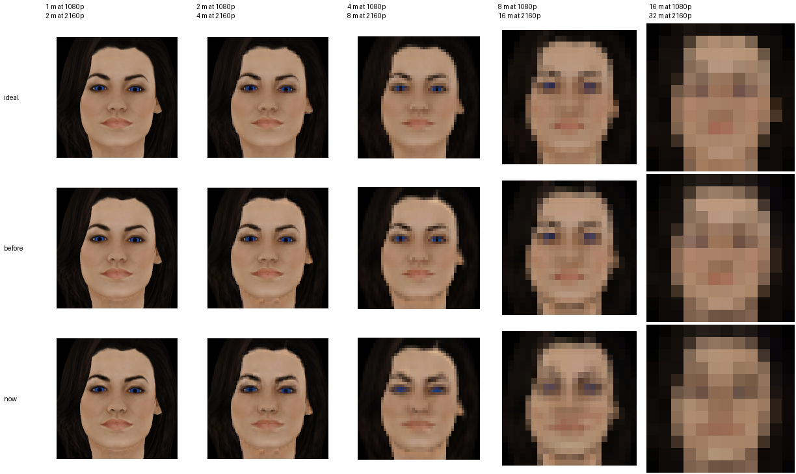

# Miranda LAS: the busty `.object` and the mip levels of the face and the eyes

Dated 2026-11-11. Two defects in `Miranda_LAS` and `Miranda_Busty_LAS` were fixed and six packs were
re-shipped: those two, and the four `Miranda_L4D2_over_*` head packs, which are built from the face texture
inside `dist/Miranda_LAS.zip`. This page is the evidence: what was read, what was measured, with what, and
what is still not known. Nothing here has been seen in the game.

## What changed

| Pack | Before | Now | Members that changed |
| --- | --- | --- | --- |
| `Miranda_LAS.zip` | 5,413,656 B, `e0e0c807…` | 5,919,788 B, `f0e9c698…` | `miranda_face_df.texture` (1,048,704 to 1,398,256 B, 1 to 11 levels), `miranda_eyes.texture` (262,272 to 349,680 B, 1 to 10 levels), `BUILD_INFO.json` |
| `Miranda_Busty_LAS.zip` | 5,815,104 B, `29644ddd…` | 6,321,190 B, `5c802b25…` | the same two textures, `fps_miranda_busty.object` (478 to 385 B), the menu icon (a render of the model with its textures: 3.5 % of its texels moved), `BUILD_INFO.json` |
| `Miranda_L4D2_over_Joy.zip` | 10,600,653 B, `2b19542b…` | 10,679,783 B, `79032405…` | the head atlas and the menu icon |
| `Miranda_L4D2_over_Clover.zip` | 7,648,225 B, `baa9b5cf…` | 7,727,355 B, `2ca4d494…` | the head atlas and the menu icon |
| `Miranda_L4D2_over_Bonnie.zip` | 8,160,274 B, `9cdb80c1…` | 8,239,404 B, `00398955…` | the head atlas and the menu icon |
| `Miranda_L4D2_over_Sydney.zip` | 7,147,084 B, `d0c88d7c…` | 7,226,214 B, `74b6794f…` | the head atlas and the menu icon |

Every other member of every pack is byte-identical, and the other eight tracked packs did not change. The two
Miranda packs were built six times, in pairs, with the sandbox wiped and the environment made again between
the pairs, and the four head packs at least four times; each came out the same every time. That says less
than it seems to: see "Does a pack depend on the machine that builds it".

## What was read

| Material | Where | Used for |
| --- | --- | --- |
| The game's Lua, decompiled, update 214 | `AzureeDev/payday-2-luajit` at `6305c67cc603`, 1,732 files | what the game does with an outfit unit; the default field of view |
| Legendary Armour Skins, Lua and 34 units | `Vladik268/P2` at `b7c38c1d`, `mod/Legendary Armour Skins` | what LAS does with an outfit unit; what `.object` files look like in units known to work |
| BeardLib | `simon-wh/PAYDAY-2-BeardLib` at `95eb1c0c` | the function LAS hooks |
| The 2B pack | `references/2b.rar` | the one LAS pack this pipeline was modelled on |
| The source addon's VTFs | `models/l4d2_miranda_lawson_1.zip` | the face's own mip levels |
| Block compression (Direct3D 10), BC3 | `MicrosoftDocs/win32` at `129846d6c4f0` | the layout of a DXT5 block |

## The `.object`

**The defect.** `fps_miranda_busty.object` listed four objects; its model has two of them. The file was a
fixed list (2B's); the model came from a builder that drops `g_head` and `g_head_lod1`. The commit that added
the variant (`73fbc856`, 2026-11-04) has that drop from its first line and gives no reason for it.

**Two ways to make them agree:** remove the two lines, or keep the two head slots in the model as the base
pack and 2B do. What uses the unit decides, so it was read.

| Who | What it does with the outfit unit | Lines |
| --- | --- | --- |
| The game | spawns it as `char_mesh`, links it by joint names, sets its material config, runs an optional sequence, enables it. It never asks it for an object by name. `g_head` occurs in none of the 1,732 files | `lib/managers/criminalsmanager.lua` 468 to 500 |
| BeardLib | the same, in its own copy of that function; no `g_head` anywhere | `Hooks/Items/PlayerStyleGloveHooks.lua` 372 to 396 |
| LAS | maps `fps_unit` to the style's `unit` and `unit` to `third_unit`; looks up objects by name only for the deployable bags of the character, each lookup guarded by `if object` | `hooks/outfits/loader.lua` 8 and 9; `hooks/las_hooks/criminalsmanager.lua` 116 to 122 |
| The unit itself | no sequence manager; its extensions are `unit_data` and `contour` | `fps_miranda_busty.unit` |

So nothing needs the head slots and either way would do. **The lines were removed**, because that changes one
text file of 478 bytes and leaves alone a model that has shipped since 2026-11-04.

**What files the game accepts show.** A census of every unit that has an `.object` beside a `.model`, names
compared by 64-bit hash as the engine does:

| Units | `<object>` lines without a node | `culling_object` without a node | First-person units that list `g_head` |
| --- | --- | --- | --- |
| LAS's own, 34 | 0 | 1 (`murky_hazmat`: `g_body_lod0`) | 0 of 15 (9 of the 15 models have a `g_head` node that the file leaves out) |
| 2B, 2 | 0 | 1 (`2b`: `c_block`) | 1 of 1, and its model has it |
| This repository's, 8, before | 2, both in `fps_miranda_busty` | 4 (every third-person unit: `c_block`, as in 2B) | 2: `fps_miranda`, which has it, and `fps_miranda_busty`, which does not |
| This repository's, 8, now | 0 | 4 | 1: `fps_miranda` |

In 36 units made by other people there is no `<object>` line without a node. The fixed file is in the shape of
the Christie packs' first-person units, which list `g_body` and `g_body_lod1` and have exactly those. The
census reads every model with this repository's own codec (`tools/pd2-las/diesel_model.py`); no second reader
was put beside it.

**Not known.** What the engine does with an `<object>` line that has no node: it reads the file in native
code. The old pack was never run. And no pack of this repository has a first-person record from the game: the
2026-11-10 screenshot review lists first-person arms among the things it did not cover.

Both Miranda builders now end on `las_pack.install_models`, which writes each `.object` from the model beside
it, so the two cannot disagree again.

## The textures

### What a pack known to work ships

`references/2b.rar` has three textures. The two on its model carry a complete chain: `base_df`, 4096x4096
DXT5, 13 levels; `base_nm`, 2048x2048 DXT5, 12 levels; both with header flags `0x0a1007` and caps `0x401008`
and a payload of exactly the size those levels need. Its menu icon is 512x512 DXT1 with one level. Before this
change `face_df` and `eyes` were the only two of the seven Miranda model textures with one level (flags
`0x081007`, caps `0x001000`). Now all seven have the header fields of 2B's and a complete chain. That is all
2B settles: it has no model texture with one level, so it does not show what the game makes of one.

### Which mip level is on screen

Vertical field of view 65 degrees; the level is log2 of texels per screen pixel, facing the camera, no bias, no anisotropic filter. A value between two levels is a blend of both.

| texture | texels per cm (median; 10th to 90th percentile) | screen | 1 m | 2 m | 4 m | 8 m | 16 m |
| --- | --- | --- | --- | --- | --- | --- | --- |
| `face_df` (1024x1024) | 46 (34 to 57) | 1080p | 2.4 | 3.4 | 4.4 | 5.4 | 6.4 |
| `face_df` (1024x1024) | 46 (34 to 57) | 2160p | 1.4 | 2.4 | 3.4 | 4.4 | 5.4 |
| `eyes` (512x512) | 103 (47 to 137) | 1080p | 3.6 | 4.6 | 5.6 | 6.6 | 7.6 |
| `eyes` (512x512) | 103 (47 to 137) | 2160p | 2.6 | 3.6 | 4.6 | 5.6 | 6.6 |

Near levels of `face_df` (on screen up to 8 m at 1080p): 0 to 6; the rest are far levels.
Near levels of `eyes` (on screen up to 8 m at 1080p): 0 to 7; the rest are far levels.

The densities are measured on `g_head` of the tracked model. The field of view is
`tweak_data.player.stances.default.standard.FOV` (`lib/tweak_data/playertweakdata.lua` 249), taken as vertical.
If the engine means it horizontally, everything is 1.78 times larger on a 16:9 screen and each column reads
1.78 times farther; the near levels are then a subset of the ones used here.

### The limits, written before anything was measured against them

| Class | Colour, mean | Colour, 99th percentile | Iris | Gloss, mean | Gloss, worst texel |
| --- | --- | --- | --- | --- | --- |
| near: on screen up to 8 m at 1080p, and level 0 | 2.0 | 6.0 | 3.0 | 1.0 | 4 |
| far: every other level | 3.0 | 10.0 | 6.0 | 1.5 | 8 |

Colour is CIEDE2000 between a texel of the reference image and the same texel decoded from the texture: about
1 is the smallest difference an eye picks out side by side, about 2 is visible on inspection. Iris is the same
difference between the mean colour of the iris ring in the reference and in the decoded level. Gloss is alpha,
in steps of 255. The reference of a level is the uncompressed image the build means for it, not a decode of
level 0.

What I had seen before writing them: mean errors in RGB of two earlier attempts, and that the 16x16 level of
both had a grey iris. No CIEDE2000 figure, and nothing from an outside encoder.

### How each level is made

**The face.** The source's VTF has eleven levels, made by its author's tool. They are not averages of its own
level 0 (a mean CIEDE2000 of 1.2 at 512x512 rising to more than 4 at 8x8, against either kind of average), which fits
levels made from the art before it was compressed. They are kept: the build decodes level 0, repaints it (eye
sockets, lash lines, 1.74 % of the texels), and adds to each lower level what the repaint added, averaged over
each texel's area as light. Then it encodes again only the half of a block whose content changed. In the end
1,731 of 87,383 blocks differ from the source's (the colour half of 1,714, the alpha half of 927); every other
byte of every level is the source's. Regenerating the lower levels from level 0 instead was tried and rejected: it is no closer to
the ideal render (1.31, 1.70 and 2.30 at 2, 4 and 8 m, against 1.24, 1.58 and 2.25) and encodes 21,847 blocks
again to change 487.

**The eyes.** Source draws its eyes with a shader, so the texture is drawn by the build: once, at 512x512,
one point per texel. Every level below is the area average of that drawing, colour averaged as light and
gloss as the number it is, encoded with a search over every pair of a block's own colours, in which a texel of
iris or pupil counts sixteen times a texel of sclera.

The task said to draw the eye at each size. **That was not done as written**, and this is the measurement
behind the choice. The yardstick is the eye drawn with 16 points per texel of level 0 and averaged. "The
build's level" is one point per texel of level 0, averaged. "Drawn at this size" is the eye drawn again with
one point per texel of that level.

| level | size | the build's level: colour mean | p99 | worst | gloss worst | iris | drawn at this size: colour mean | p99 | worst | iris |
| --- | --- | --- | --- | --- | --- | --- | --- | --- | --- | --- |
| 0 | 512x512 | 0.04 | 0.91 | 1.34 | 4 | 0.01 | 0.04 | 0.91 | 1.34 | 0.01 |
| 1 | 256x256 | 0.12 | 0.98 | 1.66 | 2 | 0.02 | 0.07 | 0.92 | 1.43 | 0.00 |
| 2 | 128x128 | 0.08 | 0.98 | 1.38 | 1 | 0.01 | 0.16 | 1.91 | 3.40 | 0.01 |
| 3 | 64x64 | 0.03 | 0.64 | 1.02 | 1 | 0.01 | 0.37 | 4.28 | 7.90 | 0.13 |
| 4 | 32x32 | 0.01 | 0.35 | 0.99 | 0 | 0.00 | 0.81 | 13.86 | 14.76 | 0.65 |
| 5 | 16x16 | 0.00 | 0.00 | 0.55 | 0 | 0.00 | 1.73 | 16.64 | 16.91 | 0.53 |
| 6 | 8x8 | 0.00 | 0.00 | 0.00 | 0 | 0.00 | 2.59 | 20.32 | 20.32 | 2.35 |
| 7 | 4x4 | 0.00 | 0.00 | 0.00 | 0 | 0.00 | 3.44 | 12.64 | 12.64 | 11.48 |
| 8 | 2x2 | 0.00 | 0.00 | 0.00 | 0 | - | 7.95 | 9.44 | 9.44 | - |
| 9 | 1x1 | 0.00 | 0.00 | 0.00 | 0 | - | 24.92 | 24.92 | 24.92 | - |

One drawing averaged down stays within 1.66 of the finer drawing in every texel of every level and keeps its
iris to 0.02. The eye drawn again at each size is as good at 512 and 256 and falls apart below, because the
fibres of the iris fall between the points: at 32x32 one texel in a hundred is off by more than 13, and at 4x4
the iris is off by 11.48. Level 0 is itself one point per texel. Against the finer drawing its worst texel is
off by 1.34 in colour, in the dark rim, and by 4 of 255 in gloss, on the pupil's edge, where gloss steps from
4 to 12. It was left as it is, and it is the reference every figure below is measured against.

**Level 0 was wrong too.** Until now the build decoded the whole face, repainted it and encoded all of it
again as one level with `dds_encode.rgba_to_bc3_dds`. That encoder wrote a texel's position on the alpha ramp
as its code. In the format, code 0 is alpha_0, code 1 is alpha_1 and codes 2 to 7 run from alpha_0 towards
alpha_1. 80 % of the face's blocks have more than one gloss value, and in those the gloss was scrambled
inside the block: 3.9 % of the texels off by two or more, the worst by 29 of 255. The one test of that
encoder used a flat image, which has a single code. The encoder is fixed; it still writes the menu icons,
whose alpha is flat, so no icon changed because of it.

**Gloss at 255.** The conversion from Source lowers gloss by scaling the two alpha endpoints of every block.
A block with alpha_0 <= alpha_1 has four interpolated values and two constants, 0 and 255, which that leaves
alone. Ten texels of the face's level 1 came out at 255. The face is now held to the ceiling the conversion
was given (42).

### The pack, level by level

Reference: the uncompressed image the build means for that level. Decoded by texture2ddecoder. Colour is CIEDE2000, gloss is alpha in steps of 255.

`face_df`, before: 1 level, 1,048,704 B

| level | size | class | colour mean | colour p99 | gloss mean | gloss max | verdict |
| --- | --- | --- | --- | --- | --- | --- | --- |
| 0 | 1024x1024 | near | 1.16 | 2.99 | 0.46 | 29 | gloss max 29.00 > 4 |

`face_df`, now: 11 levels, 1,398,256 B

| level | size | class | colour mean | colour p99 | gloss mean | gloss max | verdict |
| --- | --- | --- | --- | --- | --- | --- | --- |
| 0 | 1024x1024 | near | 0.02 | 1.15 | 0.00 | 3 | pass |
| 1 | 512x512 | near | 0.03 | 1.48 | 0.00 | 3 | pass |
| 2 | 256x256 | near | 0.05 | 1.91 | 0.01 | 3 | pass |
| 3 | 128x128 | near | 0.05 | 1.85 | 0.01 | 3 | pass |
| 4 | 64x64 | near | 0.10 | 3.59 | 0.02 | 3 | pass |
| 5 | 32x32 | near | 0.21 | 5.20 | 0.05 | 2 | pass |
| 6 | 16x16 | near | 0.15 | 2.35 | 0.03 | 1 | pass |
| 7 | 8x8 | far | 0.07 | 0.88 | 0.22 | 1 | pass |
| 8 | 4x4 | far | 0.08 | 0.34 | 0.38 | 1 | pass |
| 9 | 2x2 | far | 0.00 | 0.00 | 0.00 | 0 | pass |
| 10 | 1x1 | far | 0.00 | 0.00 | 0.00 | 0 | pass |

`eyes`, before: 1 level, 262,272 B

| level | size | class | colour mean | colour p99 | gloss mean | gloss max | iris (reference -> decoded) | iris difference | verdict |
| --- | --- | --- | --- | --- | --- | --- | --- | --- | --- |
| 0 | 512x512 | near | 1.62 | 3.84 | 0.00 | 1 | (22, 61, 126) -> (20, 62, 130) | 0.53 | pass |

`eyes`, now: 10 levels, 349,680 B

| level | size | class | colour mean | colour p99 | gloss mean | gloss max | iris (reference -> decoded) | iris difference | verdict |
| --- | --- | --- | --- | --- | --- | --- | --- | --- | --- |
| 0 | 512x512 | near | 1.35 | 3.10 | 0.00 | 0 | (22, 61, 126) -> (22, 60, 126) | 0.07 | pass |
| 1 | 256x256 | near | 1.33 | 3.33 | 0.00 | 1 | (22, 61, 127) -> (22, 61, 126) | 0.06 | pass |
| 2 | 128x128 | near | 1.49 | 4.56 | 0.01 | 1 | (22, 60, 126) -> (22, 60, 125) | 0.10 | pass |
| 3 | 64x64 | near | 1.76 | 7.47 | 0.02 | 1 | (22, 61, 127) -> (22, 60, 125) | 0.37 | colour p99 7.47 > 6 (known: the format) |
| 4 | 32x32 | near | 2.07 | 8.83 | 0.01 | 1 | (22, 60, 125) -> (24, 60, 122) | 0.50 | colour mean 2.07 > 2; colour p99 8.83 > 6 (known: the format) |
| 5 | 16x16 | near | 3.04 | 26.89 | 0.06 | 1 | (25, 57, 117) -> (20, 56, 113) | 0.88 | colour mean 3.04 > 2; colour p99 26.89 > 6 (known: the format) |
| 6 | 8x8 | near | 7.42 | 14.34 | 0.62 | 1 | (26, 59, 120) -> (24, 57, 117) | 0.67 | colour mean 7.42 > 2; colour p99 14.34 > 6 (known: the format) |
| 7 | 4x4 | near | 7.10 | 14.01 | 0.00 | 0 | (50, 63, 106) -> (57, 65, 107) | 1.71 | colour mean 7.10 > 2; colour p99 14.01 > 6 (known: the format) |
| 8 | 2x2 | far | 2.18 | 2.65 | 0.00 | 0 | - | - | pass |
| 9 | 1x1 | far | 1.66 | 1.66 | 0.00 | 0 | - | - | pass |

### The same images through each encoder

Every encoder is given the reference image of every level. Worst level of each figure, and the levels that miss a limit.

`face_df`

| encoder | colour mean | colour p99 | gloss mean | gloss max | levels that miss a limit |
| --- | --- | --- | --- | --- | --- |
| dds_encode.rgba_to_bc3_dds (bounding box) | 1.16 | 13.17 | 0.14 | 3 | 5 |
| tools/pd2-port/dds.py encode_dxt5 | 0.61 | 13.17 | 0.14 | 3 | 5 |
| dds_encode.encode_bc3_texels (every pair) | 0.51 | 5.20 | 0.38 | 3 | none |
| quicktex 0.3.1, level 5 (outside) | 0.25 | 5.10 | 0.14 | 3 | none |
| quicktex 0.3.1, level 18 (outside) | 0.22 | 5.00 | 0.14 | 3 | none |
| etcpak 0.9.15 (outside) | 2.01 | 11.77 | 0.88 | 5 | 1, 2, 3, 4, 5 |

`eyes`

| encoder | colour mean | colour p99 | gloss mean | gloss max | iris difference | levels that miss a limit |
| --- | --- | --- | --- | --- | --- | --- |
| dds_encode.encode_bc3_texels, iris weighted (what the build uses) | 7.42 | 26.89 | 0.62 | 1 | 1.71 | 3, 4, 5, 6, 7 |
| dds_encode.rgba_to_bc3_dds (bounding box) | 9.48 | 18.58 | 0.03 | 1 | 15.81 | 2, 3, 4, 5, 6, 7 |
| tools/pd2-port/dds.py encode_dxt5 | 10.27 | 25.96 | 0.03 | 1 | 23.15 | 2, 3, 4, 5, 6, 7 |
| dds_encode.encode_bc3_texels (every pair) | 7.22 | 23.05 | 0.62 | 1 | 6.96 | 3, 4, 5, 6, 7 |
| quicktex 0.3.1, level 5 (outside) | 6.71 | 21.52 | 0.03 | 1 | 8.57 | 3, 4, 5, 6, 7 |
| quicktex 0.3.1, level 18 (outside) | 6.81 | 23.00 | 0.03 | 1 | 7.26 | 3, 4, 5, 6, 7 |
| etcpak 0.9.15 (outside) | 9.31 | 18.28 | 0.94 | 1 | 15.20 | 3, 4, 5, 6, 7, 8 |

Three things follow. The encoder the build had (the bounding box) and the shared one in
`tools/pd2-port/dds.py` both lose the iris: 15.81 and 23.15, a grey iris. The pair search is level with
`quicktex` from 64x64 down and behind it above that (a mean of 1.4 against 0.8 at 512x512: `quicktex` refines
its endpoints, the pair search only picks among the block's own colours). And **no encoder meets the
per-texel colour limits on the eyes from 64x64 down to 4x4**, `quicktex` at its highest setting included. A
block holds four colours on one line, and a block of a small eye holds pupil, iris, dark rim and sclera.

Those five levels are what is on screen from under 1 m to 16 m at 1080p. The pack misses the limits there by
the amounts in the table above; they are listed as `KNOWN_MISSES` in `tools/pd2-las/mip_audit.py`, and
`tests/test_mip_audit.py` fails if the pack gets worse or better than the list. What the weights buy is the
iris limit: without them the iris of the 8x8 level is (44, 59, 87) where the picture has (26, 59, 120); with
them it is (24, 57, 117), and the iris is within 1.71 at every level. The sclera pays for it (7.42 against
7.22 at the worst level), and the lids cover most of the sclera.

The outside encoders are a yardstick and nothing else: they are installed in a separate environment, and no
byte that ships is made with them. Pillow can write DXT5 as well, but returned 192 where 240 went in on a test
ramp, so it was not used as one.

### What other decoders make of the same bytes

| texture | decoder | largest difference from texture2ddecoder, any channel, any level |
| --- | --- | --- |
| `face_df` | Pillow | 0 |
| `face_df` | tools/pd2-port/dds.py | 1 |
| `eyes` | Pillow | 0 |
| `eyes` | tools/pd2-port/dds.py | 1 |

CIEDE2000 here against scikit-image 0.26.0 on level 0 of the eyes: the formula differs by at most 6.4e-14, the whole path from sRGB by at most 0.0005.

Every level meets its limits, except the 9 misses listed in KNOWN_MISSES.

Pillow and `texture2ddecoder` truncate where a GPU interpolates alpha as a real number, so gloss read through
them can be one step lower than in the game. The encoder picks the nearest real value.

### The render

The head from the front, unlit, at the pixel sizes of 1 to 16 m at 1080p, each tile enlarged. Top: the ideal
picture, level 0 sampled so densely that no texel is skipped, averaged as light. Middle: the pack before.
Bottom: the pack now, each triangle sampled trilinearly from the level its texel density on screen calls for,
without anisotropic filtering.

Mean CIEDE2000 over the tile, unlit, trilinear without anisotropic filtering.

| row | 1 m | 2 m | 4 m | 8 m | 16 m |
| --- | --- | --- | --- | --- | --- |
| before | 0.87 | 0.96 | 1.12 | 1.46 | 2.09 |
| now | 0.99 | 1.24 | 1.58 | 2.25 | 3.17 |

**The pack before is closer to the ideal in every column. By itself that does not say the fix is wrong, and it
does not say it is right.** With one level, every screen pixel takes the texel its centre lands on: right on
average, and different in the next frame. With the pyramid, every pixel takes an average, which is steadier
and blurrier, and blurrier still on triangles that face away, where the level is chosen by the longer axis. A
still shows the blur and cannot show the crawl.

The eyes at 8 m are where it shows most: in the bottom row they are grey-blue, in the other two blue. An eye
is three pixels wide there. The levels on screen are the 8x8 and the 4x4 one, a texel of which is 0.6 and 1.2
cm of eyeball, and the sampler blends neighbouring texels, so iris and sclera run together: (34, 52, 96) at
the centre of the eye, where the drawn iris averages (20, 57, 120). At 4 m the eyes are blue in all three
rows. Any texture with mip levels is sampled this way, 2B's included, so this is what a small eye can be
expected to look like at that distance; whether it is how you want it to look is step D of
`docs/pd2-las/in-game-checklist.md`, and only the game, in motion, shows what the levels are for.

## The four head packs

`tools/build_joy_head_mods.py` takes the face from `dist/Miranda_LAS.zip`, so a fresh build of the four L4D2
head packs stopped matching the tracked bytes when the face was fixed. They were rebuilt. In each, the head
atlas (2048x2048, 12 levels) and the menu icon changed. 17.5 % of the atlas's level 0 differs, all of it in
the face quarter. Against the face the Miranda build means, that quarter went from a mean CIEDE2000 of 1.42
to 0.57 and its gloss from a mean error of 0.64 to 0.22 of 255, measured on the Joy pack; the other three
changed by the same figures. The head builder's own handling of gloss was not audited. The four Romance packs
and `Geralt_over_Rust` do not read that file and did not change.

## Does a pack depend on the machine that builds it

> Superseded on 2026-11-12. The causes are fixed, the comparison that allowed a difference is deleted, and CI
> compares every zip with its sha256: [`2026-11-12-cpu-independence.md`](2026-11-12-cpu-independence.md).

The task asked for CI to rebuild both packs on a clean runner and compare them with the tracked sha256. Two
things stand in the way, and both were found by trying.

**No workflow has run in this repository since 2026-10-22.** It has 121 runs, and the last is the `star chart`
schedule of 2026-10-22 21:33 UTC. Nineteen pull requests were merged after that (#11 to #29), this branch was
pushed and a pull request opened for it, and the schedule fires every six hours: nothing started a run. The
three workflows are listed as active. The setting that would explain it (Settings, Actions, General) cannot
be read with the access this session has. Until runs start again, nothing under `.github/workflows/` checks
anything, this change included.

**The tracked bytes depend on the CPU.** Every builder was run again with numpy and OpenBLAS held to the
routines they pick on other CPUs (`NPY_DISABLE_CPU_FEATURES`, `OPENBLAS_CORETYPE`): as this sandbox has them
(AVX-512), as a CPU with AVX2 has them, which is what most of GitHub's runners are, and as one with SSE4.2.

| Pack | With the routines of an AVX2 CPU | Of an SSE4.2 CPU |
| --- | --- | --- |
| `Miranda_LAS`, `Miranda_Busty_LAS` | 18 of 20 members are the same bytes, among them `face_df`, `eyes`, every `.object` and the icon. The third-person model differs in 136 bytes of 1,819,989 (of 2,398,661 in the busty pack), and `BUILD_INFO.json` in the sha256 it records for that model | the same two members; 174 bytes |
| `Christie_LAS`, `Christie_LAS_Slim` | both models of each (953 and 638 bytes in `Christie_LAS`) and `BUILD_INFO.json` | the same members |
| the four L4D2 and the four Romance head packs | the head atlas, in 8 or 9 bytes of 5,592,560 | the same bytes as with AVX2 |
| `lawson_las`, `Geralt_over_Rust` | the same bytes | the same bytes |

So "a rebuild gives the same bytes" (D9) is true on a CPU like this one. On another kind, 14 of the 16 tracked
zips do not equal a fresh build. That the packs of this change came out the same after every wipe of the
sandbox says only that the sandboxes are one kind of machine: the two that were looked at had AVX-512.

What differs in the Miranda model:

- Positions, normals, UVs, weights, bones and triangles are the same. Only UV directions differ.
- 44 vertices of the hair have no triangle with area in UV (`g_head` and `g_head_lod1` share them, and the
  shadow caster has copies). The UV map gives such a vertex no handedness, and
  `build_models.author_group_sections` then takes the sign of its V direction from `dot(cross(n, u), v)` with
  a fallback `v` that lies in the plane of `n` and `u`: a number that is zero but for rounding. With the AVX2
  routines 16 of the 44 come out reversed, with the SSE4.2 ones 21.
- With the SSE4.2 routines one U direction of 9,874 also differs in its last bits.
- OpenBLAS decides it: with only OpenBLAS switched the model is the AVX2 one, and with only numpy's own
  routines switched it is the tracked one. The positions the builder works with differ in digits that a
  32-bit float does not keep, and that sign is the one place where they show.

In the game this is the tangent frame of 44 hair vertices whose triangles cover no area of the hair texture.
No effect of it was looked for.

What differs in a head atlas: 18 texels of level 0 and one of level 1, by up to 9 of 255, all inside the
quarter that holds the eye the head builder draws (`build_crisp_miranda_eye_texture`); the Romance packs have
one more, in the face quarter. Here numpy's own routines decide and OpenBLAS does not. The Miranda build draws
its eye the same way, with single-precision `arctan2` and powers: 4 of its 786,432 values come out one step
different without AVX-512. Its encoder happens to give the same blocks for both, so `eyes` is the same bytes
on all three. The face repaint uses the same kind of arithmetic and is also the same bytes on all three.

**What was done about it.** The builders were not changed: the sign belongs to every third-person model, the
Christie ones included, and the drawn eye of the head packs to eight packs this change was not about. What
changed is the check. `make -sC tools/pd2-las fresh` builds both Miranda packs again into `build/fresh/`,
which leaves the tracked zips alone, and `tools/pd2-las/fresh_check.py` compares them with the tracked packs
member by member. Every member has to be the same bytes, except a model, whose floats may differ in their last
bits and whose V direction may be reversed at a vertex without UV area; `BUILD_INFO.json` may differ in the
hash of such a model. It prints which of the two it found:

| Built with | `make -sC tools/pd2-las fresh` |
| --- | --- |
| this sandbox as it is | both packs: all 20 members are the same bytes as the tracked pack |
| the routines of an AVX2 CPU | both packs: 18 of 20 the same bytes; the model as allowed (136 bytes, 32 V directions reversed, which is 16 vertices and their copies in the shadow caster); `BUILD_INFO.json` as allowed |
| the routines of an SSE4.2 CPU | both packs: 18 of 20 the same bytes; the model as allowed (174 bytes, 42 V directions reversed) |
| the packs before this change, for comparison | fails: `face_df`, `eyes`, the busty `.object` and the busty icon "have to be the same bytes" |

`.github/workflows/test.yml` runs `make -sC tools/pd2-las env fresh` as its last step, and can now be started
by hand from the Actions tab. When this was written it had never run on a runner. The nearest thing that could be done here: in a
clone of the pushed branch with no environment, no templates and no build output, that command takes a minute,
passes, and changes no tracked file, with the sandbox's routines and with those of an AVX2 CPU. That is still
this machine. The test suite does not care which routines it gets either: held to those of an AVX2 CPU it
gives the same 780 passed, 29 skipped and 2 expected failures.

**2026-11-12: the first run on a runner.** Actions was switched on again and `test.yml` was started by hand on
this branch (run 43194541009). Every step that existed before passed. The new step failed within a second,
with exit code 2 and nothing built, and the cause was the job, not the CPU: two steps earlier `bin/um` runs
through `uv`, which makes a `.venv` without pip on an interpreter of its own choosing; `recover_env.sh` took
any `.venv/bin/python` for the build's environment and then called `.venv/bin/pip`. Reproduced here with `uv`
installed: the same error and the same exit code, in 14 ms. `recover_env.sh` and `bootstrap.sh` now start the
venv again when it has no pip. The rehearsal in a clean clone could not find this, because the sandbox has no
`uv`: it rehearsed the command, not the job.

This session cannot open a run's log: the host that serves it is not reachable from the sandbox. It can read
step results and annotations, so the step now writes the runner's CPU and the comparison's lines as notices.
What the runs after this fix reported is in pull request #30.

**Not tested:** another C library (a newer glibc, Windows, macOS) and another architecture. Holding the
routines down on one machine is not the same as building on another.

## Found beside the task, measured, not changed

- **Texels at full gloss in other textures.** The same constant survives in textures this change does not
  touch. Exactly 255, all levels together: `body_df` 132 and `head_df` 244 in both Miranda packs;
  `c02_01_df` 799, `c02_02_df` 1,449 and `body_df` 2 in both Christie packs. Read with `texture2ddecoder`.
- **The Christie sleeve-gloss pass** reads and writes alpha codes in ramp order
  (`dds_encode._dxt5_alpha_decode` and `_dxt5_alpha_encode`). The two mistakes cancel when a block uses its
  whole ramp and do not otherwise. Run on the alpha blocks of the tracked Christie textures with the builder's
  factor, 21 to 24 % of the blocks that are not flat come out with a texel more than 2 off, the worst by 25
  to 27 of 255. This is a measurement of the pair on real blocks, not of what the pass did to the blocks it
  was given at build time.
- **CI did not rebuild the Miranda packs.** The step named "the tracked pack must equal a fresh build"
  rebuilds `lawson_las.zip` and compares the other zips with their own sidecars. The step added here is
  described in the section above, with what keeps it from running.
- **The bytes of 14 tracked packs depend on the CPU that builds them**, as measured in the section above:
  the sign of a V direction where the UV map gives none (the four LAS packs), and the eye the head builder
  draws (the eight head packs).

All four are in the README's Next or dealt with as stated.

## What would settle the rest

| From your machine | What it settles |
| --- | --- |
| `crash.txt`, `crashlog.txt` and the BLT log after one heist in first person with the busty outfit | whether the first-person unit loads as it is now |
| Screenshots of the character a few metres away, moving, with the old pack and the new, and the resolution, FOV, texture quality and anisotropic filter you run | whether the mip levels do what they are for; whether the eyes read as blue |
| `units/pd2_dlc_trd/characters/trd_acc_jumpsuits/trd_acc_fps_jumpsuit/trd_acc_fps_jumpsuit.object` and `.model`, from the extracted game files | the same census on a first-person outfit unit the game itself ships (`playerstyletweakdata.lua` 36) |
| The version of Legendary Armour Skins you have installed | whether the Lua read here is the Lua you run |
| What `make -sC tools/pd2-las env fresh` prints on a Linux machine or WSL of yours (needs `python3`, `node` and `npm`; it changes no tracked file) | whether a machine that is not this sandbox builds the same textures and the same `.object`, and how its model differs |
| Whether Actions is switched on for the repository (Settings, Actions, General), and the log of the `test` workflow once it runs | the same, on a runner; and whether the new last step works there at all |

## How to repeat it

`make -sC tools/pd2-las audit` prints the tables with Pillow as the decoder and without the outside encoders.
For the full report, in an environment that is not the build's: `pip install quicktex==0.3.1 etcpak==0.9.15
texture2ddecoder==1.0.6 scikit-image "numpy==2.4.6" "pillow==13.0.0"`, then
`python tools/pd2-las/mip_audit.py --before OLD.zip --sheet OUT.png`, where `OLD.zip` is
`git show 13538a1:dist/Miranda_LAS.zip`. The CIEDE2000 used here gives the twelve published test values of
Sharma, Wu and Dalal that the tests pin, and matches scikit-image 0.26.0 on them.

The comparison across CPUs: `make -sC tools/pd2-las fresh` as it is, and again with
`OPENBLAS_CORETYPE=Haswell NPY_DISABLE_CPU_FEATURES="X86_V4 AVX512_ICL AVX512_SPR"` in front of it for the
routines of an AVX2 CPU, or `OPENBLAS_CORETYPE=Nehalem NPY_DISABLE_CPU_FEATURES="X86_V3 X86_V4 AVX512_ICL
AVX512_SPR"` for those of an SSE4.2 one. The first variable alone moves the model, the second alone the head
atlases. For the other packs the builders were run the same way and the zips compared member by member.
