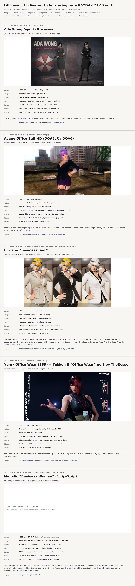

# Office-suit source models for a PAYDAY 2 LAS outfit

> Generated by `tools/pd2-las/suit_source_board.py`. Do not hand-edit;
> edit `CANDIDATES` in the script and re-run it.

Recon only — nothing here is ported, and no game asset ships in this repo.

Full-resolution sheet: [`suit-sources/board.png`](suit-sources/board.png).

## Why these four, and not Skyrim again

The Skyrim 3BA attempt (`STATUS.md`, `FIXES-2026-11-04.md`) failed on three
things that are *source-artist* decisions, not retarget bugs: layered
BodySlide sheets that poke through each other, sleeves that stop 6–8 cm short
of the wrist, and an HDT-SMP skirt chain that Diesel cannot drive. A good
source therefore has to have those three decided correctly *before* the port:

| requirement | why |
| --- | --- |
| ≤ 4 bone weights per vertex | Diesel skins 4; Source games clip to 3 |
| ~60 deform bones, humanoid names | the LAS rig is `las_target_skeleton.json` |
| rigid, thigh-weighted skirt | no cloth physics in a PD2 heister model |
| sleeves or gloves reach the wrist | PD2 spawns the glove *at* the hand joint |
| one baked diffuse + normal set | Diesel has no PBR stack |

## Ranked

| # | game | mod / costume | verdict | skirt | weights | licence |
| --- | --- | --- | --- | --- | --- | --- |
| 1 | Resident Evil 4 (2023) | Ada Wong Agent Officewear | **A** (4.5) | rigid | 4 carried | conversion + asset use allowed |
| 2 | Dead or Alive 6 | Ayane Office Suit HD (DOA5LR / DOA6) | **B** (3.5) | rigid and thigh-weighted; designed for kicks | studio-painted, 4 carried | check the costume's rip source; figure mods are grey-area |
| 3 | Dead or Alive 6 / DOAXVV | Yom · Office Wear (SSR) + Tekken 8 “Office Wear” port by TheRessen | **B** (3.5) | rigid leather pencil skirt | 4 carried | TheRessen's TK8 mod permits asset reuse and modification |
| 4 | Dead or Alive 6 | Christie “Business Suit” | **B** (3.0) | rigid | studio-painted, 4 carried | vanilla Koei Tecmo asset — reuse is not licensed (see note) |
| 5 | Skyrim SE | Melodic “Business Woman” (1.zip–5.zip) | **D** (1.0) | ✗ 13 physics bones + a cloth chain Diesel cannot drive | needs a clamp | “do not publish outside LoversLab without permission” |

## Notes per candidate

### 1. Ada Wong Agent Officewear — Resident Evil 4 (2023)  ·  RE Engine

- **Outfit:** grey blazer + white blouse + knee-length pencil skirt + pumps
- **Author:** MrGreenEyes (Nexus 5310)
- **Bones:** ~120 (RE Engine) — 22 used by a LAS outfit
- **Weights:** 4 carried; ship "skin weight limit = 4"
- **Hands/wrists:** kept — blazer sleeve ends at the wrist
- **Skirt:** rigid, thigh-weighted, knee-length (no chain, no cloth)
- **Textures:** ~4-6 MB albedo/normal/gloss, matte wool (no PBR stack)
- **Licence:** conversion + asset use allowed, credit MrGreenEyes
- **Route:** .pak -> RE Mesh Editor -> .fbx/.smd -> LAS retarget
- **Where:** <https://www.nexusmods.com/residentevil42023/mods/5310>

closest match to the 3BA brief; sleeves reach the wrist, so PD2's changeable gloves work and no sleeve extension is needed

### 2. Ayane Office Suit HD (DOA5LR / DOA6) — Dead or Alive 6  ·  (DOA6LR, Team NINJA)

- **Outfit:** black blazer + white shirt + short pencil skirt + fishnet + heels
- **Author:** DOA6 mod (AutoLink / REDELBE)
- **Bones:** ~90 — 20 used by a LAS outfit
- **Weights:** studio-painted, 4 carried; ship with a 4-weight clamp
- **Hands/wrists:** kept, but the rig is a fighter's, not a heister's
- **Skirt:** rigid and thigh-weighted; designed for kicks, so it survives a crouch
- **Textures:** classic diffuse/normal/specular — the easiest shader match
- **Licence:** check the costume's rip source; figure mods are grey-area
- **Route:** .g1m -> gltf/fbx (Blender) -> LAS retarget
- **Where:** <https://ayakamods.com/games/dead-or-alive-5-last-round.92/>

best skirt/shoulder weighting of the four; DOA5LR/6 share the same costume library, and DOA6's High Society set is a corset, not office wear, so use the Office Suit mods instead

### 3. Yom · Office Wear (SSR) + Tekken 8 “Office Wear” port by TheRessen — Dead or Alive 6 / DOAXVV  ·  Yom tie-up

- **Outfit:** black turtleneck + leather pencil skirt + tights + heels
- **Author:** Team NINJA × Yom  ·  TK8 port by TheRessen
- **Bones:** ~90 — 20 used by a LAS outfit
- **Weights:** 4 carried; already re-rigged once by TheRessen for TK8
- **Hands/wrists:** kept; TK8 mod ships full hands
- **Skirt:** rigid leather pencil skirt, thigh-weighted, hem at the knee
- **Textures:** diffuse/normal/gloss; tights are separate geometry with 5 deniers
- **Licence:** TheRessen's TK8 mod permits asset reuse and modification
- **Route:** TK8 .pak -> .uasset -> fbx -> LAS retarget
- **Where:** <https://tekkenmods.com/mod/3737/office-wear-mod-for-all-female-characters-tk8>

the cleanest office *silhouette* of the set (turtleneck, pencil skirt, tights); TK8's port is the practical way in, and its licence is the permissive one

### 4. Christie “Business Suit” — Dead or Alive 6  ·  (Team NINJA)  — same asset as DOA5LR Costume 2

- **Outfit:** tailored blazer + open shirt + pencil skirt; 3 colourways (black / white / beige)
- **Author:** Team NINJA (vanilla asset, 3 recolours)
- **Bones:** ~85 — 20 used by a LAS outfit
- **Weights:** studio-painted, 4 carried; 4-weight clamp
- **Hands/wrists:** kept, thin fighter hands (finger bones exist)
- **Skirt:** rigid, thigh-weighted, hem above the knee
- **Textures:** diffuse/normal/specular, all in the game's .tpf archives
- **Licence:** vanilla Koei Tecmo asset — reuse is not licensed (see note)
- **Route:** .tpf + .g1m -> Blender -> LAS retarget
- **Where:** <https://deadoralive.fandom.com/wiki/Christie/Dead_or_Alive_5_costumes>

the only *literally* office-suit costume on the list: tailored blazer, open shirt, pencil skirt, three recolours. It is a vanilla Koei Tecmo asset, so a port can only ever be a private build — never a release. Design caveat: the blazer is buttoned *open* with a deep V, so the chest is bare skin, not a blouse

### 5. Melodic “Business Woman” (1.zip–5.zip) — Skyrim SE  ·  CBBE 3BA  —  this repo's own failed attempt

- **Outfit:** 3BA body + blazer + bustier + pencil skirt + heels + necklace
- **Author:** Melodic (LoversLab) — port cancelled 2026-11-04
- **Bones:** ~115, but HDT-SMP chains for the skirt and necklace
- **Weights:** needs a clamp; sheet-split UV islands carry mismatched weights
- **Hands/wrists:** ✗ sleeves stop 6.3 cm short of the PD2 RightHand joint
- **Skirt:** ✗ 13 physics bones + a cloth chain Diesel cannot drive
- **Textures:** 2048² albedo/normal/metal, plus a hand-authored skin set
- **Licence:** “do not publish outside LoversLab without permission”
- **Route:** .nif -> nifly -> smd (tools/skyrim-nif), already written
- **Where:** <docs/skyrim-nif/STATUS.md>

the control case, and the reason the four above are ranked the way they are: layered BodySlide sheets poke through each other, the sleeve/hand gap exposed floating gloves, the shirt collar flared over the blazer, and the skirt is physics-driven. Keep it here as the baseline that “A” candidates must beat

## Also considered, and why not

| source | outfit | why it is not on the board |
| --- | --- | --- |
| RE3R — “Jill Wild Secretary” (Lemi21) | white blouse, grey pencil skirt, glasses, stockings | right silhouette, but the mesh is watermarked, the re-upload is not the author's, and Lemi21's mods are not licensed for reuse |
| RE4R — “Ada Office Lady” (Aerosmith) | office blazer + skirt set | a 2.8 GB NSFW pack with the garment split across many add-ons; wrong tone, and heavy to audit before a single vertex moves |
| RE4R — “Ashley Wild Secretary” (Lemi21) | white shirt + mini skirt | the still that surfaced for it is half-undressed; off-brief for a heister outfit and unlicensed for reuse |
| DOA6 — “[Revival] High Society” | white blouse, corset, long skirt | verified from the official set art: it is a corset-and-long-skirt costume, not office wear, so it does not meet the brief |
| Tekken 8 — “TFD Business Suit” | tailored business suit | a TK8 customisation pak, and its office-wear sibling is itself a DOAXVV port — so it is a downstream copy of candidate 3, with an extra conversion step |

## What to do next

1. Pick one — rank A first, `01-re4r-ada-agent-officewear`.
2. Extract the mod and import it into Blender (RE Mesh Editor for RE Engine,
   `g1m` importers for DOA, FModel + an import add-on for the TK8 pak).
   Export a rigged `.smd`/`.fbx`.
3. Feed it through the pipeline this repo already has for exactly this shape:
   `tools/pd2-las/build_business_woman.py` (Skyrim clothing → LAS body) —
   `weld_open_seams`, `extend_sleeves_to_wrist` and `follow_layer_weights`
   are the passes a suit body needs, and `skin_texture` bakes the skin set.
   `build_models.py` builds the L4D2 body instead and takes no `--source`.
4. Then the usual `bust_variant` / preview / publish path.
5. Re-read `docs/skyrim-nif/FIXES-2026-11-04.md` before touching shoulders,
   sleeves or the skirt — that is where the last attempt lost the game.

Licences are recorded as found; nothing here grants redistribution.
