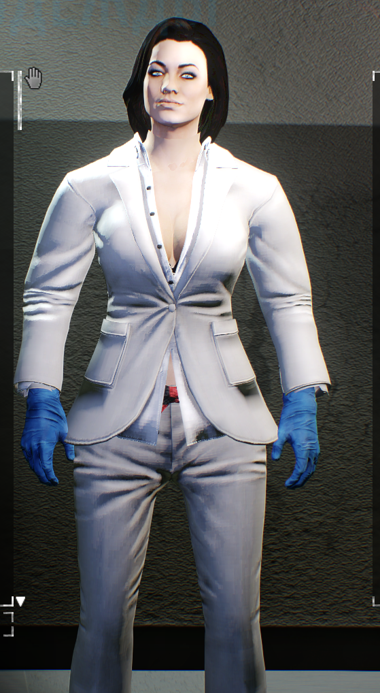
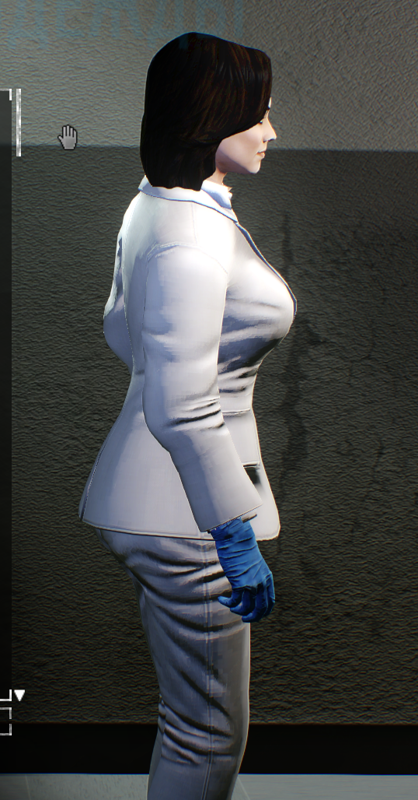
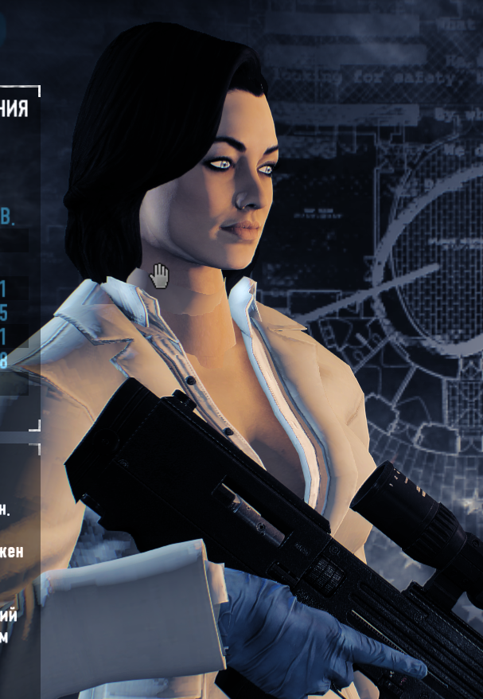

# User-supplied in-game captures — Christie LAS

Original PNG uploads, archived without alteration. Outfit-menu front and side views and a menu/lobby upper-body view with a rifle.

Pack: `dist/Christie/Christie_LAS.zip`. The installed bytes were not hash-verified; the captures alone cannot prove which build was installed. The head and blue gloves are supplied at runtime.

| Upload | Capture | View |
| --- | --- | --- |
| `image-13.png` | [`christie_menu_front.png`](christie_menu_front.png) | outfit menu, front |
| `image-14.png` | [`christie_menu_side.png`](christie_menu_side.png) | outfit menu, side |
| `image-18.png` | [`christie_lobby_threequarter.png`](christie_lobby_threequarter.png) | menu/lobby, upper body with rifle |

These stills do not verify animation, first-person arms, glove fit in every pose, or heist performance. See `manifest.json` for dimensions and checksums.

## Screenshots

### Outfit menu, front

### Outfit menu, side

### Menu/lobby, upper body with rifle

