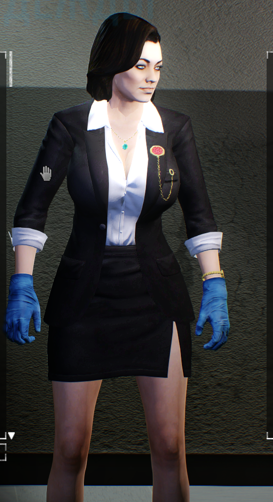
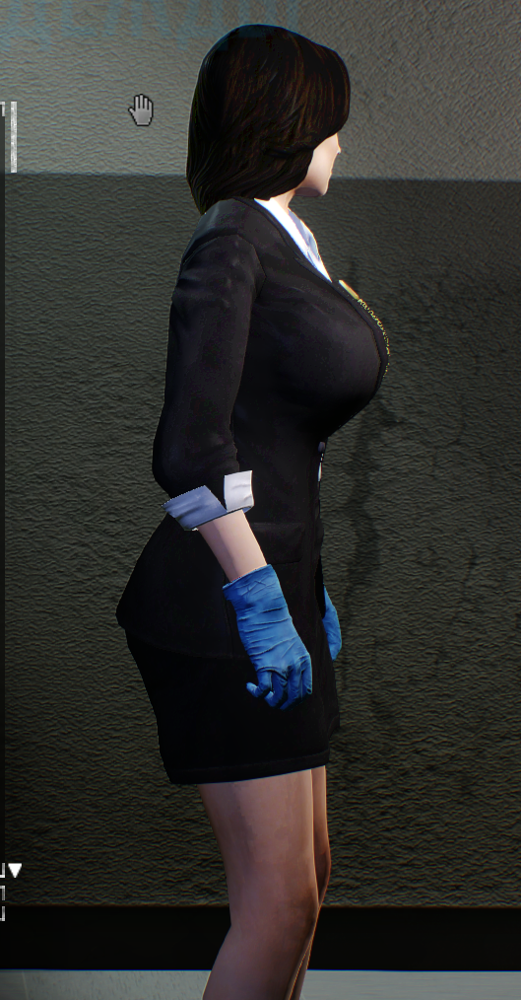
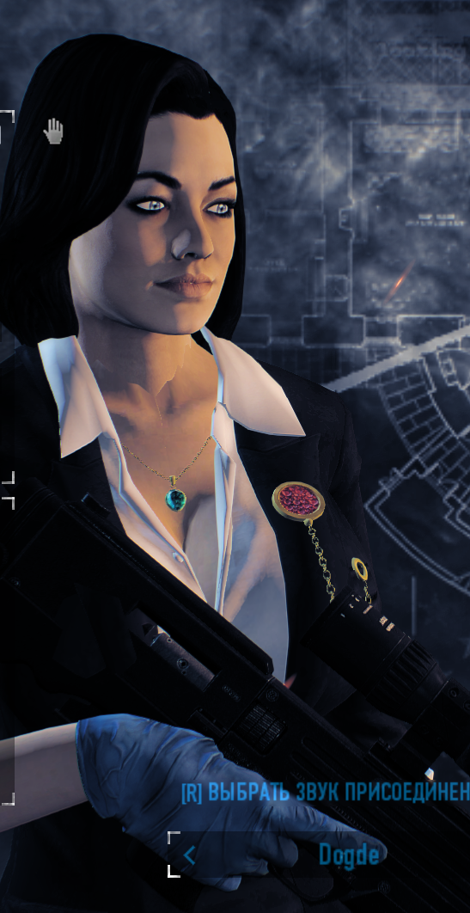

# User-supplied in-game captures — OfficeSuite

Original PNG uploads, archived without alteration. Outfit-menu front and side views and a menu/lobby upper-body view with a rifle.

> Renamed Honoko5 → OfficeSuite on 2026-11-22 (D54); the captures were taken of the pack
> under its old name.

Pack: `dist/Honoka/OfficeSuite.zip` (pre-`Tex_23(L_23)2.dds` jewelry diffuse update; see D50 and `tools/pd2-las/MODLOG.md`). The installed bytes were not hash-verified; the captures alone cannot prove which build was installed, and they predate the later `Tex_23(L_23)2.dds` jewelry swap. The head and blue gloves are supplied at runtime.

| Upload | Capture | View |
| --- | --- | --- |
| `image-15.png` | [`officesuite_menu_front.png`](officesuite_menu_front.png) | outfit menu, front |
| `image-16.png` | [`officesuite_menu_side.png`](officesuite_menu_side.png) | outfit menu, side |
| `image-17.png` | [`officesuite_lobby_threequarter.png`](officesuite_lobby_threequarter.png) | menu/lobby, upper body with rifle |

These stills do not verify animation, first-person arms, glove fit in every pose, or heist performance. See `manifest.json` for dimensions and checksums.

## Screenshots

### Outfit menu, front

### Outfit menu, side

### Menu/lobby, upper body with rifle

